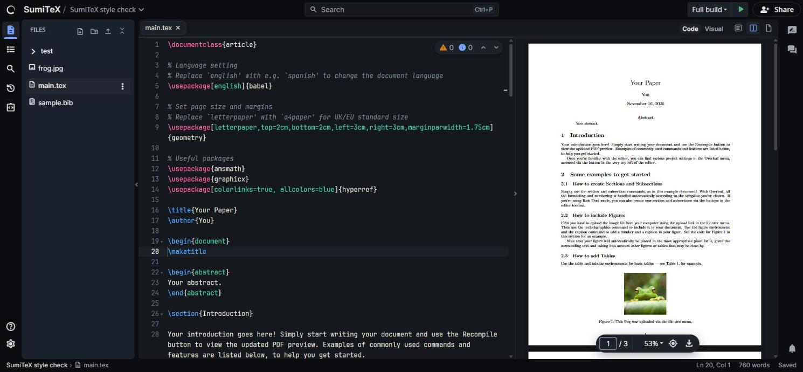

<h1 align="center">
  <br>
  SumiTeX
</h1>

<p align="center">A calm, minimalist LaTeX editor you host yourself.</p>

<p align="center">
  <a href="https://github.com/bigphu/sumitex/releases">Releases</a> •
  <a href="#run-it">Run it</a> •
  <a href="#roadmap">Roadmap</a> •
  <a href="SUMITEX-FEATURES.md">Features</a> •
  <a href="#built-on">Built on</a> •
  <a href="#licence">Licence</a>
</p>



SumiTeX (墨, *sumi*: the ink of brush calligraphy) is a LaTeX editor for writing in peace. The document fills the window; everything else stays quiet until you need it. It is built on [AyakaLeaf Pro](https://github.com/ayaka-notes/ayakaleaf-pro), itself built on [Overleaf](https://github.com/overleaf/overleaf), so real-time collaboration, track changes, history, Git and Dropbox sync and the rest are all still there.

## What's different

- **Islands.** Thin strips on a dark frame around rounded panels, after JetBrains IDEs. Dark and light themes, a vivid syntax palette and JetBrains Mono.
- **One island for the editor and the PDF**, with Source, Split and PDF views and a floating pill for page, zoom, jump to the cursor and download.
- **A run widget** in the title bar: Full build, Draft, or **Current chapter only**, which compiles just the chapter you're in.
- **A compile log that stays short**: one line per problem with filters, package-loading chatter folded away, search, Jump to first error, and Accept for warnings you've decided to live with. It opens when a compile fails and gets out of the way when it's clean.
- **Problems in the editor**: counts with next and previous, inline markers and an overview ruler.
- **Zen mode**: a centred column, typewriter scrolling and no chrome.
- **Back where you left off**: the file, cursor, PDF page and open folders come back when you reopen a project.
- **Install as an app** for a window of its own, with SumiTeX's title bar as the window's.
- **VS Code keys**: Ctrl+D for the next match, Ctrl+L, Ctrl+G, Alt+↑/↓, Ctrl+1/2/3 for the views, Ctrl+Shift+E/H/M for files, history and problems, and more. They step aside for Vim and Emacs.
- **A command palette** that works like VS Code's: Ctrl+P for files, Ctrl+Shift+P for commands, `@` for sections, `#` for labels, `:` for a line, with recent files and suggested commands before you type.
- **A shortcut sheet** (Ctrl+K Ctrl+S) with every key in one place, an index and a filter.
- **A live linter** that underlines a command whose package isn't loaded, with a one-click "Add \usepackage" fix (Ctrl+.), plus checks for undefined references, duplicate labels, missing citations and missing files.
- **Plain-language errors** in the Problems panel, with links and an "Add package" button where that's the fix.
- **Snippets that bring their packages:** `\fig`, `\booktab`, `\eq`, `\thm`… add their `\usepackage` lines as they go in. Projects can share their own snippets, and you can keep personal ones for every project.
- **Math auto-expansion:** `//` to `\frac{}{}`, `@a` to `\alpha`, `->` to `\to`, `mat3x4` to a 3 × 4 matrix, inside math only, with your own rules.
- **A snippet library:** every snippet and shortcut in one place, with a filter, what each inserts, and a switch for each built-in shortcut. Snippets and shortcuts share one plain-text format, and take sizes (`\table3x4`, `\elist5`).
- **An equation preview that stays put:** a block under the math, steady while you type, keeping the last good render while the formula is half-written.
- **Folders for your projects:** nested, colour-coded folders on the dashboard. Drag projects onto them, drag folders to rearrange, and open one to see everything inside it. The project list itself sits in islands, like the editor.

Nothing Overleaf or AyakaLeaf offers is removed: stock parts are restyled, moved, or one setting away. [SUMITEX-FEATURES.md](SUMITEX-FEATURES.md) lists every agreed feature and how it behaves.

## Run it

**On a server, for you or a group:** [deploy/README.md](deploy/README.md) builds the SumiTeX image and runs it with Docker Compose behind HTTPS, with sandboxed compiles, backups and upgrades covered.

```shell
git clone https://github.com/bigphu/sumitex.git
cd sumitex
deploy/build-image
```

**To work on SumiTeX itself**, use the development environment in [`develop/`](develop/README.md) (Docker with Compose; on Windows, use WSL 2):

```shell
cd sumitex/develop
bin/build
bin/up
bin/dev web webpack
```

Then open <http://localhost/launchpad> to create the first admin account. `bin/dev web webpack` gives live reload. `develop/dev.rc` switches the heavier extras (LDAP, SAML, S3, Grafana, …) on or off.

## Roadmap

| Phase | What | Status |
|---|---|---|
| 1 | Minimalist layout, run widget, Zen mode, installable app, compile log panel | Done, [v0.1.0](https://github.com/bigphu/sumitex/releases/tag/v0.1.0) |
| 2 | VS Code keys, the command palette and the shortcut sheet | Done, [v0.2.0](https://github.com/bigphu/sumitex/releases/tag/v0.2.0) |
| 3 | A live linter with one-click "add package" fixes, plain-language errors | Done, [v0.3.0](https://github.com/bigphu/sumitex/releases/tag/v0.3.0) |
| 4 | Snippets that bring their packages, math auto-expansion | Done, [v0.4.0](https://github.com/bigphu/sumitex/releases/tag/v0.4.0) |
| 5 | Folders for projects on the dashboard | Done, [v0.5.0](https://github.com/bigphu/sumitex/releases/tag/v0.5.0) |
| 6 | Moving list items and table columns, the Outline with blocks, image paste and drop | Done, [v0.6.0](https://github.com/bigphu/sumitex/releases/tag/v0.6.0) |
| 7 | Notion-like editing on the Visual editor | Later |

## Built on

SumiTeX stands on two projects, and is grateful to both:

- [**AyakaLeaf Pro**](https://github.com/ayaka-notes/ayakaleaf-pro) by ayaka-notes: Overleaf Community Edition with the Pro features added (SSO, sandboxed compiles, Git and Dropbox sync, the AI assistant, …). Its README lives on in [doc/AYAKALEAF-README.md](doc/AYAKALEAF-README.md). SumiTeX follows it on the `ayakaleaf` branch.
- [**Overleaf**](https://github.com/overleaf/overleaf), the collaborative LaTeX editor both are built from.

SumiTeX's own code lives in [`services/web/modules/sumitex/`](services/web/modules/sumitex/), plus a few small upstream edits marked `// SumiTeX`, so upstream updates merge cleanly.

SumiTeX does not include, copy or unlock Overleaf Server Pro.

## Contributing

Bug reports and ideas are welcome in [Issues](https://github.com/bigphu/sumitex/issues). For pull requests, keep SumiTeX code in its module and check both themes; the pull request template has the list.

## Licence

SumiTeX is free software under the [GNU Affero General Public License v3.0](LICENSE), like the AyakaLeaf Pro and Overleaf code it is built on. If you run a changed version for others to use over a network, the AGPL asks you to offer them its source.
